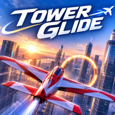

# TOWERGLIDE (타워글라이드)

> 빌딩 사이, 한계 없이.



고층 빌딩 숲을 비행기로 누비는 3D 아케이드 비행 게임. **Android(Google Play) + iOS(App Store)**, Unity 6.3 LTS + URP + C#. 싱글·오프라인, 광고·로그인·개인정보 수집 없음.

- **FREE FLIGHT** — 도시를 자유 비행. 충돌해도 바로 복귀, 거리·속도·고도 기록
- **SKYLINE RUN** — 협곡·크레인·드론·스카이브리지를 지나 링 12개를 순서대로. 콤보·근접 회피 점수
- **HANGAR** — 소형 프로펠러기 · 전투기형 제트 · 중형 여객기 중 선택(기종마다 비행 특성이 다름)
- **서울 오픈월드 준비** — 250m 청크 스트리밍 구조. 현재 도시는 절차적 테스트 데이터(실제 서울 데이터 0건)
- 조작: 왼손 플로팅 조이스틱(기울이면 선회) + 오른손 BOOST / BRAKE. 첫 비행에 조작 튜토리얼

---

## 🧭 지금 상태 한눈에 (2026-11-08 — 다음 작업은 여기부터)

**한 줄 요약**: Unity 없이 할 수 있는 작업은 **실기기 테스트 직전까지 모두 끝났다**. Phase 0~3(기반·조작·도시·UI/오디오), 서울 오픈월드 OW0~OW1(좌표계·청크 스트리밍), 기체 선택 AC0~AC1(3종·격납고), 한글 폰트, 실기기 측정 도구까지 코드·문서가 준비됐다.
**아직 한 번도 Unity로 열거나 실행하지 않았다**(개발 PC에 Unity 없음). 다음 단계는 **Unity 설치 → 컴파일 오류 수정 → 에디터 테스트 → 실기기 테스트**다.

### 검증 상태
| 범위 | 상태 |
|---|---|
| Core 로직 테스트(EditMode 119개) | ✅ GitHub Actions `core-tests`(.NET 8, C# 9)에서 전체 통과 ([최근 실행](https://github.com/Logic-Phantom/TOWERGLIDE/actions/runs/42467820554)) |
| Unity로 프로젝트 열기·컴파일(Runtime·Editor 코드) | ⬜ 미실행 — Unity 미설치 |
| Unity Test Runner(EditMode 119 + PlayMode 24) | ⬜ 미실행 |
| 에디터 메뉴(프로젝트 설정·씬 생성·코스 검증·빌드) | ⬜ 미실행(코드만) |
| 조작감·기체 3종 차이 | ⬜ 미실행 — 가장 먼저 확인할 것 |
| 화면 배치·한글 폰트·사운드·튜토리얼 | ⬜ 미실행 |
| 청크 스트리밍 실제 동작·메모리 | ⬜ 미실행 |
| Android 실기기·APK/AAB | ⬜ 미실행 — 절차는 [DEVICE_TEST_GUIDE](docs/DEVICE_TEST_GUIDE.md) |
| iOS(Xcode·TestFlight) | ⬜ 미실행 — macOS 필요 |
| 스토어 등록 | ⬜ 계정 없음 |

### 외부 서비스·계정 (비밀 값은 여기에 적지 않음)
| 서비스 | 상태 |
|---|---|
| GitHub `Logic-Phantom/TOWERGLIDE` | ✅ `main` 최신 푸시, Actions `core-tests` 자동 실행 |
| Unity(Personal) | ⬜ 설치·로그인 필요 |
| Google Play Console | ⬜ 미가입(US$25 1회) |
| Apple Developer Program | ⬜ 미가입(연회비) |
| GitHub Pages(개인정보처리방침) | ⬜ 미설정 — `docs/legal/privacy.html` 준비됨 |

### 알려진 위험(처음 열 때 볼 곳)
- Runtime·Editor 코드는 **Unity 컴파일러로 검증된 적이 없다**. 오류 가능성이 높은 곳: 에디터 생성기(씬·청크 분할·프리팹·파티클·텍스처 임포터), URP 설정 API, Android/iOS 빌드 후처리(`#if UNITY_ANDROID/UNITY_IOS`라 플랫폼 전환 후 처음 컴파일됨).
- 비행 튜닝 값은 계산상 시작점이다 — 실제 조작감은 플레이로 맞춰야 한다(항력 보상 추력 도입으로 재튜닝 필요, D-036).
- 품질 자동 선택 기준(RAM 4/8GB, 코어 6/8개)·청크 예산은 추정값이다 — 실측 후 조정.
- 합성 사운드 품질, 1920×1080 기준 UI 배치(21:9·태블릿 겹침)는 실기기에서 확인해야 한다.

---

## 앞으로 진행할 일

### A. 지금 바로 — Unity 설치부터 실기기 1차 테스트까지
> 전체 절차·명령어·체크리스트: **[docs/DEVICE_TEST_GUIDE.md](docs/DEVICE_TEST_GUIDE.md)**

1. **Unity 설치**: Unity Hub → **6.3 LTS** + Android Build Support(OpenJDK, SDK & NDK) (+ iOS Build Support).
2. **프로젝트 열기**: Hub ▸ Add ▸ `C:\eclipse_AI\TOWERGLIDE` → 버전 경고 시 설치한 6.3 LTS 선택 → 컴파일 오류는 Console 전체를 Claude Code에 붙여 넣어 수정.
3. **메뉴 실행**: `TOWERGLIDE ▸ 1. 프로젝트 설정 적용`(입력 방식 변경으로 재시작될 수 있음) → `2. 씬 생성` → `3. 코스 검증`(문제 0건).
4. **에디터 테스트**: Test Runner ▸ EditMode·PlayMode Run All → 실패는 실기기 전에 해결.
5. **조작감 튜닝(Phase 1 완료 조건)**: `CityFlight` Play(키보드 + Device Simulator) → [FLIGHT_PHYSICS](docs/FLIGHT_PHYSICS.md) 표대로 `AircraftFlightTuning` 조정 → 승인 기준 7개. 기체 3종 각각.
6. **Android 실기기**: 개발 APK로 기능 테스트(14개 항목) → 성능 측정용 APK로 FPS·발열·메모리 측정(오버레이 "복사" → [PERFORMANCE](docs/PERFORMANCE.md)·[SEOUL_WORLD_PERFORMANCE](docs/SEOUL_WORLD_PERFORMANCE.md)). 빌드마다 `Builds/Android/permissions-report.txt` 확인.
7. **결과 기록**: [TEST_PLAN](docs/TEST_PLAN.md)·`WORKLOG.md`·이 README의 검증 상태.

### B. 다음 개발 단계 (상세: [ROADMAP](docs/ROADMAP.md))
| 단계 | 할 일 | 시작 조건 |
|---|---|---|
| **Phase 4 비주얼·최적화** | 기체 모델(그레이박스 → 독자 모델), 부스트 화염·비행운 VFX, 조명·안개 다듬기, 텍스처 압축 규칙, Occlusion Culling 검토, 실기기 프로파일링, 품질 단계 기준 조정 | 실기기 1차 측정 후 |
| **OW1 마무리** | 최고 속도+부스트 청크 연속 통과 스트레스 테스트, 청크 크기·반경·예산 조정, 로드 시간·메모리 기록 | Unity 실행 후 |
| **OW2 Seoul Core** | 한 권역(우선 후보: 여의도·한강) 실제 데이터 임포트 — 임포터·청크 빌더·검증기·라이선스 보고서, 랜드마크 1~3개 | 데이터 라이선스 확정(C-3) |
| **OW3~OW5** | 권역 2~4개 연결, 권역 진입 라벨·2D 지도·랜드마크 표시, 선택형 활동(교량 통과·랜드마크 서킷·고도 도전), 권역 확대 | OW2 완료 |
| **AC2 기체 연출** | 기체별 독자 모델·재질·프로펠러/엔진 연출·사운드 다듬기, 성능 요약 UI 완성 | 조작감 확정 후 |
| **AC3~AC4 라인업** | 곡예기·지역 여객기·대형 여객기·화물기 추가, 기체별 코스(제트용 넓은 게이트, 여객기 공항 접근 등)·해금 조건 | AC2 |
| **선택 개선** | TextMeshPro 전환(선명한 글자), 음악(라이선스 확인 음원), 자이로 조작 옵션, 추가 모드(TIME ATTACK·PRECISION·WIND·NIGHT) | 필요 시 |
| **Phase 5 출시 준비** | 확정 아이콘·Android 적응형 아이콘, 스플래시, 실제 플레이 스크린샷, 스토어 문안 확정, 처리방침 게시, AAB·TestFlight, 비공개 테스트(Play 12명×14일) | 실기기 안정화 후 |

### C. 소유자가 결정·진행할 것
1. **패키지/번들 ID** `com.logicphantom.towerglide` 확정 — 첫 업로드 후 변경 불가(D-004).
2. **출시 아이콘** 확정 — 현재는 시안을 자른 임시 아이콘(D-055). 생성 도구·출처·유사 상표 여부 확인.
3. **서울 데이터** — OSM(ODbL) 파생 데이터 공개 방식, 사용할 공공 데이터셋 선택([SEOUL_WORLD_DATA_SOURCES](docs/SEOUL_WORLD_DATA_SOURCES.md)).
4. **iOS 빌드 환경** — Mac 직접 / GitHub Actions macOS / 클라우드 빌드 중 선택.
5. **계정·법률** — Play Console·Apple Developer 가입, 업로드 키 생성·백업, 상표 검색(KIPRIS), 지원 이메일, 처리방침 게시, 타깃 연령(13세 이상 권장) — [RELEASE_CHECKLIST](docs/RELEASE_CHECKLIST.md).

---

## 설치·실행
요구 사항: Unity 6.3 LTS(6000.3.x), Windows 또는 macOS. iOS 빌드는 macOS + Xcode.

```text
Unity Hub ▸ Add ▸ (이 폴더) ▸ 열기
TOWERGLIDE ▸ 1. 프로젝트 설정 적용
TOWERGLIDE ▸ 2. 씬 생성 (프리팹·기체·청크 씬·MainMenu·CityFlight)
TOWERGLIDE ▸ 3. 코스 검증
Assets/_Project/Scenes/MainMenu.unity ▸ Play   (또는 CityFlight에서 바로)
```

에디터 조작: W/S 피치(W = 상승) · A/D 롤 · Q/E 요 · ↑/↓ 스로틀 · Shift 부스트 · Space 브레이크 · C 카메라 · R 복귀 · Esc 일시정지(뒤로가기) · F2 측정 오버레이. 터치는 Window ▸ General ▸ Device Simulator. 자세히: [TOUCH_CONTROLS](docs/TOUCH_CONTROLS.md).

## 테스트
- Unity: Window ▸ General ▸ Test Runner ▸ EditMode / PlayMode ▸ Run All (PlayMode 씬 테스트는 씬 생성 후 실행, 그 전엔 Ignore)
- Unity 없이 Core만(.NET 8 SDK 필요):
```bash
dotnet test tools/core-tests
```
- GitHub Actions: `core-tests`(push마다 자동, 실패 시 테스트 이름·이유가 주석으로 표시), `unity-build`(수동, Unity 라이선스 시크릿 필요)

## 빌드
| 산출물 | 메뉴(`TOWERGLIDE ▸ Build ▸`) | 용도 |
|---|---|---|
| 개발 APK | Android APK (개발·실기기 테스트) | 기능 테스트. 측정 오버레이·기기 로그·Profiler 연결, 디버그 키 |
| 성능 측정 APK | Android APK (성능 측정용) | 릴리스 최적화 + 측정 오버레이. FPS·발열 기록용 |
| Google Play AAB | Android AAB (Google Play 릴리스) | 업로드 키 환경 변수 `TOWERGLIDE_KEYSTORE_PATH/PASS`, `TOWERGLIDE_KEY_ALIAS/_PASS` |
| iOS | iOS Xcode 프로젝트 | macOS Xcode에서 서명 → Archive → TestFlight |

버전은 `build/version.json` 한 곳에서 관리(업로드마다 `build` +1). 출력은 `Builds/`(git 제외). 빌드 전 `설정 검증` 메뉴로 IL2CPP·ARM64·targetSdk 36·Development 여부를 확인한다.

## 구조
```
Assets/_Project/
  Scripts/Core/      순수 C#(Unity 없이 테스트) — Input · Flight · Gameplay · Save · App
                     World(코스·도시 레이아웃·Geo 좌표계·Streaming) · Aircraft · Audio · Tutorial
  Scripts/Runtime/   App · Flight · Input · Cameras · Gameplay · World · Save · Platform · Audio · UI
  Editor/            프로젝트 설정 · 씬/청크 생성 · 건물·프리팹·기체 팩토리 · 코스 검증 · 빌드 · 플랫폼 후처리
  Tests/             EditMode(Core 119) · PlayMode(24)
  Art/               Fonts(Pretendard) · Icons(임시) · Materials · Textures · Buildings(생성 메시)
  Prefabs/ Scenes/(Chunks/) Settings/(Aircraft/ Rendering/ World/) Resources/(기체 카탈로그·라이선스)
build/version.json · tools/core-tests/ · .github/workflows/ · docs/ · brand/
```
의존 방향 `Editor → Runtime → Core`. 입력 `UI·키보드 → FlightInputRouter → AircraftFlightController`. 게임 규칙은 `FlightSession` 한 곳. 자세히: [ARCHITECTURE](docs/ARCHITECTURE.md), [SEOUL_WORLD_ARCHITECTURE](docs/SEOUL_WORLD_ARCHITECTURE.md), [AIRCRAFT](docs/AIRCRAFT.md).

## 문서
| 문서 | 내용 |
|---|---|
| [ARCHITECTURE](docs/ARCHITECTURE.md) · [DECISIONS](docs/DECISIONS.md) | 계층·흐름·확장 지점 / 결정 기록 D-001~D-055 |
| [SUPERPROMPT](docs/SUPERPROMPT.md) · [애드온 명세](docs/SUPERPROMPT_ADDON_SEOUL_AIRCRAFT.md) · [PROMPT_REVIEW](docs/PROMPT_REVIEW.md) | 원본 명세 / 서울·기체 추가 명세 / 검토·보완 사항 |
| [GAME_DESIGN](docs/GAME_DESIGN.md) · [FLIGHT_PHYSICS](docs/FLIGHT_PHYSICS.md) · [TOUCH_CONTROLS](docs/TOUCH_CONTROLS.md) · [AIRCRAFT](docs/AIRCRAFT.md) | 모드·코스·장애물·점수·화면 / 물리·튜닝 / 조작 / 기체 라인업 |
| [SEOUL_WORLD_ARCHITECTURE](docs/SEOUL_WORLD_ARCHITECTURE.md) · [SEOUL_WORLD_DATA_SOURCES](docs/SEOUL_WORLD_DATA_SOURCES.md) · [SEOUL_WORLD_PERFORMANCE](docs/SEOUL_WORLD_PERFORMANCE.md) | 오픈월드 설계 / 데이터 라이선스 / 스트리밍 성능 기록 |
| [DEVICE_TEST_GUIDE](docs/DEVICE_TEST_GUIDE.md) · [TEST_PLAN](docs/TEST_PLAN.md) · [PERFORMANCE](docs/PERFORMANCE.md) | 실기기 테스트 절차 / 테스트 매핑·결과 / 최적화·측정 |
| [RELEASE_CHECKLIST](docs/RELEASE_CHECKLIST.md) · [APP_STORE_AND_COSTS](docs/APP_STORE_AND_COSTS.md) · [STORE_LISTING](docs/STORE_LISTING.md) | 두 스토어 출시 절차 / 비용 / 등록 문안 |
| [PRIVACY](docs/PRIVACY.md) · [legal/privacy.html](docs/legal/privacy.html) · [BRAND_AND_TRADEMARKS](docs/BRAND_AND_TRADEMARKS.md) · [THIRD_PARTY_ASSETS](docs/THIRD_PARTY_ASSETS.md) | 개인정보 / 처리방침 / 상표·아이콘 / 에셋·폰트 라이선스 |
| [ROADMAP](docs/ROADMAP.md) · [WORKLOG](WORKLOG.md) · [CLAUDE.md](CLAUDE.md) | 단계별 진행 / 작업 일지(상세) / 에이전트 작업 규칙 |

---

## 변경 내역 (Changelog)

### 실기기 테스트 준비 — 2026-11-08
- **측정 도구**(개발·성능 측정 빌드 전용): FPS·1% Low·최대 프레임·30fps 미만 비율·메모리·기기·청크 상태 오버레이(세 손가락 탭, 값 복사), 기기 내 로그 파일(adb로 수집)
- **성능 측정용 APK 메뉴**: 릴리스 최적화 + 측정 오버레이
- **첫 실행 품질 자동 선택**(RAM·코어 기준, 저사양 30fps) + 단계별 청크 메모리 예산, 설정 초기화 시 기기 기본값 재계산
- **Android 뒤로가기**: 설정·격납고 닫기 → 두 번 눌러 종료, 비행 중 일시정지
- **출시 설정 자동화**: 한국어 홈 화면 이름 "타워글라이드"(Android·iOS), iOS 암호화 미사용 값, 빌드마다 Android 권한 점검 보고서
- **임시 앱 아이콘**(시안 → 1024/512/192 PNG) + 스플래시 배경
- **[실기기 테스트 가이드](docs/DEVICE_TEST_GUIDE.md)**: 준비·빌드 3종·설치/로그 명령·14개 항목·문제 해결·기록 양식
- 테스트: EditMode 111 → 119(CI 통과)

### 한글 폰트 — 2026-11-08
- **Pretendard v1.3.9 Regular·Bold**(SIL OFL 1.1): 공식 저장소에서 받아 크기·형식·해시 확인, 한글 11,172자·UI 기호 지원 확인
- 모든 UI 텍스트에 적용(굵게 = Bold 파일), 없는 글자는 OS 한글 폰트로 대체, 🔒 이모지 → "잠김"
- 설정 ▸ 라이선스에 저작권 고지 + OFL 전문(스크롤)
- 방식: uGUI 동적 폰트(TMP 전환은 Unity 확인 후 선택)

### Phase 3 — 2026-11-08 · UI·오디오·진행
- **설정 화면**(메인 메뉴·일시정지 공용): 그래픽·프레임·조작 감도·카메라 흔들림·피치 반전·조이스틱 방식·볼륨 3종·진동·튜토리얼 다시 보기·초기화·라이선스 — 즉시 적용·저장, 비행 중 즉시 반영
- **사운드**(외부 음원 0개, 코드 합성): 기체별 엔진 루프(프로펠러·제트·터보팬)·바람·충돌·링(콤보마다 음 상승)·근접 회피·부스트·버튼 클릭
- **조작 튜토리얼**: 첫 비행 시 롤 → 선회 → 피치 → 부스트, 실제 조작을 유지해야 진행, SKIP 가능
- **라이선스 고지** 화면
- 테스트: EditMode 94 → 111(CI 통과), PlayMode 18 → 24
- 미포함: 음악(D-044)

### 애드온 OW0·OW1·AC0·AC1 — 2026-11-08 · 서울 오픈월드 준비 + 기체 선택
- **OW0**: 기존 구조·충돌 분석, 데이터 출처·라이선스 기록(전부 검토 대기/참고용, 사용 0건), 좌표계 EPSG:5186 TM(왕복 오차 <1mm 테스트), 청크·LOD·메모리 초안
- **OW1**: 테스트 도시를 250m 청크 씬 16개로 분할, `ChunkStreamingPlanner`(속도·방향·부스트 프리로드, 히스테리시스, 예산, 실패 재시도) + Additive 비동기 로더, 원거리 실루엣, 시작 시 청크 대기, 나침반·스트리밍 디버그 HUD
- **AC1**: 기체 3종(소형 프로펠러기·전투기형 제트·중형 여객기) 튜닝·프리팹·정의, 개발 예정 4종, 격납고(카드·3D 미리보기·상대 성능 막대·해금 조건), 선택 저장(저장 v2), 기체 크기별 카메라, 여객기 SKYLINE 차단
- 비행: 항력 보상 추력(순항 속도 정확히 유지) — 조작감 재튜닝 필요
- 테스트: EditMode 65 → 94(CI 통과), PlayMode 11 → 18

### Phase 2 — 2026-11-08 · 도시·장애물 코스
- **도시**: Core `CityLayoutGenerator`(시드 고정, 코스 주변 자동 비우기) + 건물 아키타입 12종 모듈, LODGroup, 미터 UV 창문 텍스처 3종, 경고등·옥상 설비·안테나
- **장애물 8종 프리팹**: 링, 크레인(고정·회전), 드론, 광고판 프레임, 스카이브리지, 케이블 존, 안테나, 화물 기구
- **코스**: Core `SkylineCourses`·`CourseValidator`, `TOWERGLIDE ▸ 3. 코스 검증` 메뉴, 09~12번 링 재배치(CI가 찾은 스카이브리지 지지 건물 충돌 수정)
- **피드백**: 충돌·링·근접 회피 VFX(오브젝트 풀), 다음 링 빛기둥, 경계 방향 화살표, 근접 회피 가장자리 플래시·진동
- 테스트: EditMode 50 → 65(CI 통과), PlayMode 6 → 11. CI: 실패 테스트를 GitHub 주석으로 출력

### 0.1.0 (build 1) — 2026-11-08 · 프로젝트 부트스트랩
- Unity 6.3 LTS 프로젝트 골격, asmdef 4계층(Core/Runtime/Editor/Tests), 패키지 매니페스트
- 비행 물리(질량 무관 가속도·목표 각속도·협조 선회·실속·부스트 게이지), 터치 조이스틱·버튼, 키보드/게임패드, 추적 카메라(충돌 회피·FOV·흔들림)
- FREE FLIGHT / SKYLINE RUN 세션, 12링 코스, 근접 회피, 경계, 안전 지점 복귀, 일시정지·결과·재시작
- 로컬 저장(원자적 쓰기·버전·손상 복구), 햅틱, 품질 3단계, SafeArea HUD, 메인 메뉴
- 에디터 자동화: 프로젝트 설정·씬 생성·빌드(AAB/APK/iOS Xcode)
- 테스트 EditMode 50 / PlayMode 6, CI(core-tests, unity-build), 문서 17종, 개인정보처리방침 초안, 출시 체크리스트(Android+iOS)

---

## 작업 내역 (Work Log)
상세 기록(변경 파일·테스트 결과·위험): [WORKLOG.md](WORKLOG.md)

| # | 날짜 | 작업 | 결과 | 커밋 |
|---|---|---|---|---|
| 1 | 2026-11-08 | 환경 조사(Unity·.NET 없음 확인), 원본 명세 검토(15개 보완), 구조·아키텍처·핵심 코드·에디터 자동화·테스트·CI·문서 | Core 50 테스트 CI 통과 | `ae5239f` `b950f52` |
| 2 | 2026-11-08 | Phase 2: Core 도시·코스 데이터, 건물 12종·장애물 8종·VFX 프리팹, 피드백, 코스 검증 메뉴, 씬 테스트 | CI 1차 실패로 코스 설계 결함 발견·수정 → Core 65 통과 | `24dafbd` `782e951` `08c5dea` `92278c3` `1464e8a` |
| 3 | 2026-11-08 | 애드온 적용(OW0·OW1·AC0·AC1): 좌표계·청크 스트리밍·실루엣, 기체 3종·격납고·저장 v2, 데이터 라이선스 기록 | Core 94 통과 | `dd29e47` `707b264` `e7a545a` |
| 4 | 2026-11-08 | Phase 3: 설정 화면·합성 사운드·튜토리얼·라이선스 고지 | Core 111 통과 | `3eaec4d` `a006ef4` `0cbf4e8` |
| 5 | 2026-11-08 | 한글 폰트 Pretendard(OFL) 도입, 라이선스 전문 표시 | 파일·글자 지원 검증 | `14e9cef` |
| 6 | 2026-11-08 | 실기기 테스트 준비: 측정 오버레이·로그·품질 자동 선택·뒤로가기·한글 앱 이름·iOS plist·권한 점검·임시 아이콘·가이드 | Core 119 통과 | `3f99921` `8a0f015` |
| 7 | 2026-11-08 | README 전면 정리(현재 상태·앞으로 진행할 일·작업 내역) | 문서 | (이 커밋) |

**전체 공통**: 모든 작업은 Unity 미설치 환경에서 진행했다. 검증은 Core 로직 CI 테스트까지이며, Runtime·Editor·실기기 검증은 위 "앞으로 진행할 일 A"부터 시작한다.
