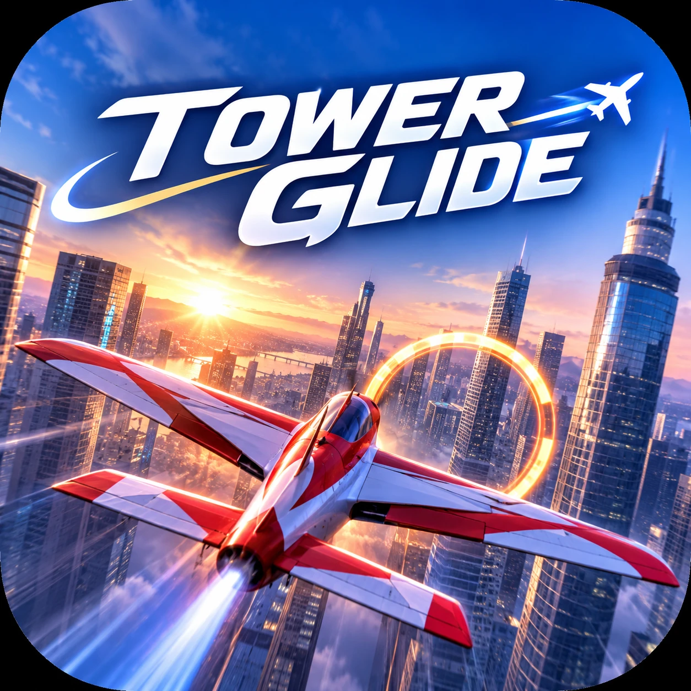

# TOWERGLIDE (타워글라이드)

> 빌딩 사이, 한계 없이.



고층 빌딩 숲을 소형 곡예 비행기로 누비는 3D 아케이드 비행 게임. **Android(Google Play) + iOS(App Store)**, Unity 6.3 LTS + URP + C#, 싱글·오프라인·개인정보 수집 없음.

- **FREE FLIGHT** — 도시를 자유 비행, 충돌해도 바로 복귀, 거리·속도·고도 기록
- **SKYLINE RUN** — 협곡·크레인·드론·스카이브리지를 지나 링 12개를 순서대로, 콤보·근접 회피 점수
- **HANGAR** — 소형 프로펠러기·전투기형 제트·중형 여객기 중 선택(기종마다 다른 비행 특성)
- 서울 오픈월드 확장 준비 — 청크 스트리밍 구조(현재 도시는 절차적 테스트 데이터, 실제 서울 데이터 없음)
- 조작: 왼손 플로팅 조이스틱(기울이면 선회) + 오른손 BOOST/BRAKE

## 🧭 지금 상태 한눈에 (2026-11-08 Phase 3 + 애드온 OW0·OW1·AC1 코드 완료 — 다음 작업은 여기부터)

**한 줄 요약**: Phase 0~3 코드 완료(Phase 3 = 설정 화면·합성 사운드·조작 튜토리얼·라이선스 고지) + 서울 오픈월드·기체 선택 애드온의 첫 단계 — **좌표계(EPSG:5186)·250m 청크 스트리밍·원거리 실루엣**, **기체 3종(Scout P-1 / Viper F-9 / Cityliner 180)·격납고·선택 저장**. 실제 서울 지도 데이터는 라이선스 확인 전이라 **0건**. **개발 PC에 Unity가 없어 아직 한 번도 열거나 실행하지 않았다** — 다음 단계는 Unity 설치 → 컴파일 오류 수정 → 조작감 튜닝.

### 검증 상태
| 범위 | 상태 |
|---|---|
| Unity로 프로젝트 열기·컴파일 | ⬜ 미실행 (Unity 미설치) |
| EditMode 테스트(Core, 111케이스) | ✅ GitHub Actions `core-tests`(.NET 8, C# 9)에서 전체 통과 ([최근 실행](https://github.com/Logic-Phantom/TOWERGLIDE/actions/runs/42467226975)) · ⬜ Unity Test Runner에서는 미실행 |
| PlayMode 테스트(24케이스: 비행·씬 흐름·기체 비교·오픈월드·저장 파일·사운드·튜토리얼) | ⬜ 미실행 |
| 설정·사운드·튜토리얼 실제 화면·소리 | ⬜ 미실행 — 가로 화면 겹침·음량 균형·터치 크기 확인 필요 |
| 청크 스트리밍 실제 동작·메모리 | ⬜ 미실행 — `docs/SEOUL_WORLD_PERFORMANCE.md` 기록 양식만 |
| 기체 3종 조작감 차이 | ⬜ 미실행(테스트만 작성) |
| 씬 생성·코스 검증 메뉴 | ⬜ 미실행 (코드만 작성) |
| 에디터 Play·조작감 | ⬜ 미실행 |
| Android 실기기 / AAB | ⬜ 미실행 |
| iOS / Xcode | ⬜ 미실행 (macOS 필요) |
| 스토어 등록 | ⬜ 계정 없음 |

### 외부 서비스·계정 (비밀 값은 여기에 적지 않음)
| 서비스 | 상태 |
|---|---|
| GitHub `Logic-Phantom/TOWERGLIDE` | ✅ `main` 푸시 |
| Unity(Personal) | ⬜ 설치·로그인 필요 |
| Google Play Console | ⬜ 미가입(US$25 1회) |
| Apple Developer Program | ⬜ 미가입(연회비) |
| GitHub Pages(처리방침) | ⬜ 미설정 — `docs/legal/privacy.html` 준비됨 |

## 다음 할 일 (순서대로)
1. **Unity 설치**: Unity Hub → Unity **6.3 LTS** + Android Build Support(OpenJDK, SDK & NDK) + iOS Build Support.
2. **프로젝트 열기**: Hub ▸ Add ▸ `C:\eclipse_AI\TOWERGLIDE` → 버전 경고가 나오면 설치한 6.3 LTS 선택 → 컴파일 오류가 있으면 Claude Code에 Console 로그를 주고 수정.
3. **메뉴 실행**: `TOWERGLIDE ▸ 1. 프로젝트 설정 적용`(입력 방식 변경 시 재시작) → `TOWERGLIDE ▸ 2. 씬 생성` → `TOWERGLIDE ▸ 3. 코스 검증` → Test Runner에서 EditMode/PlayMode 실행.
4. **Phase 1 조작감 튜닝**: `CityFlight` Play → 키보드와 Device Simulator로 비행 → `docs/FLIGHT_PHYSICS.md` 표대로 `AircraftFlightTuning` 조정 → 승인 기준 7개 체크.
5. **Android 실기기**: `TOWERGLIDE ▸ Build ▸ Android APK` → `adb install -r` → 터치 조작·프레임 확인.
6. **애드온 확인**: 격납고에서 3종 선택 → FREE FLIGHT 비행 차이, 여객기로 SKYLINE RUN이 막히는지, 청크가 로드/언로드되며 도시가 끊기지 않는지(HUD 왼쪽 아래 스트리밍 디버그), 제트 부스트로 도시를 가로질러도 앞 청크가 제때 나오는지 → `docs/SEOUL_WORLD_PERFORMANCE.md`.
7. **Phase 3 확인**: 메인 메뉴·일시정지 ▸ SETTINGS(값 바꾸고 앱 재시작 후 유지되는지), 첫 비행 튜토리얼, 엔진음(기체별)·바람·링·충돌 소리 크기 균형, **한글이 Pretendard로 보이는지**(`TOWERGLIDE ▸ 2. 씬 생성`을 다시 실행해야 적용).
8. **Phase 2 눈으로 확인**: 건물 형태·창문 정렬·LOD 전환, 장애물이 "보고 피할 수 있는지", 링 빛기둥·경계 화살표·근접 회피 플래시가 과하지 않은지.
9. 그 다음: Phase 4 — 비주얼 폴리싱(기체 모델·VFX·조명)·실기기 프로파일링·품질 옵션 튜닝(`docs/ROADMAP.md`).
10. **서울 데이터(OW2) 전 결정 [소유자]**: OSM ODbL 파생 데이터 공개 방식, 사용할 공공 데이터셋 — `docs/SEOUL_WORLD_DATA_SOURCES.md`.
11. 출시 준비(소유자): 패키지 ID 확정(D-004), 상표 검색, Play/Apple 계정, 업로드 키, 처리방침 게시 — `docs/RELEASE_CHECKLIST.md`.

## 설치·실행
요구 사항: Unity 6.3 LTS(6000.3.x), Windows 또는 macOS. iOS 빌드는 macOS + Xcode.

```text
Unity Hub ▸ Add ▸ (이 폴더) ▸ 열기
TOWERGLIDE ▸ 1. 프로젝트 설정 적용
TOWERGLIDE ▸ 2. 씬 생성 (MainMenu + CityFlight)
Assets/_Project/Scenes/CityFlight.unity ▸ Play  (또는 MainMenu에서 시작)
```

에디터 조작: W/S 피치(W = 상승) · A/D 롤 · Q/E 요 · ↑/↓ 스로틀 · Shift 부스트 · Space 브레이크 · C 카메라 · R 복귀 · Esc 일시정지. 터치는 Window ▸ General ▸ Device Simulator. 자세히: `docs/TOUCH_CONTROLS.md`.

## 테스트
- Unity: Window ▸ General ▸ Test Runner ▸ EditMode / PlayMode ▸ Run All
- Unity 없이 Core만(.NET 8 SDK 필요):
```bash
dotnet test tools/core-tests
```
- GitHub Actions: `core-tests`(push마다 자동), `unity-build`(수동, Unity 라이선스 시크릿 필요)

## 빌드
| 산출물 | 메뉴 | 비고 |
|---|---|---|
| 개발 APK | TOWERGLIDE ▸ Build ▸ Android APK | 디버그 키, 실기기 테스트용 |
| Google Play AAB | TOWERGLIDE ▸ Build ▸ Android AAB | 업로드 키 환경 변수 `TOWERGLIDE_KEYSTORE_PATH/PASS`, `TOWERGLIDE_KEY_ALIAS/_PASS` 필요 |
| iOS | TOWERGLIDE ▸ Build ▸ iOS Xcode 프로젝트 | macOS Xcode에서 Archive → TestFlight |

버전은 `build/version.json` 한 곳에서 관리(업로드마다 `build` +1). 출력은 `Builds/`(git 제외).

## 구조
```
Assets/_Project/
  Scripts/Core/      순수 C# 규칙(입력 정규화·부스트·공력·체크포인트·점수·근접 회피·상태·저장 검증)
  Scripts/Runtime/   App · Flight · Input · Cameras · Gameplay · World · Save · Platform · UI
  Editor/            프로젝트 설정 · 씬 생성 · 빌드
  Tests/             EditMode(Core) · PlayMode(비행)
  Art/ Prefabs/ Scenes/ Settings/
build/version.json · tools/core-tests/ · .github/workflows/ · docs/ · brand/
```
의존 방향 `Editor → Runtime → Core`, 입력 흐름 `UI·키보드 → FlightInputRouter → AircraftFlightController`. 자세히: `docs/ARCHITECTURE.md`.

## 문서
| 문서 | 내용 |
|---|---|
| [ARCHITECTURE](docs/ARCHITECTURE.md) | 계층·런타임 흐름·씬 생성·확장 지점 |
| [DECISIONS](docs/DECISIONS.md) | 결정 기록 D-001~ |
| [PROMPT_REVIEW](docs/PROMPT_REVIEW.md) | 원본 명세 검토·보완 15항목 |
| [GAME_DESIGN](docs/GAME_DESIGN.md) · [FLIGHT_PHYSICS](docs/FLIGHT_PHYSICS.md) · [TOUCH_CONTROLS](docs/TOUCH_CONTROLS.md) | 모드·코스·장애물·점수 / 물리 모델·튜닝 / 조작 |
| [PERFORMANCE](docs/PERFORMANCE.md) · [TEST_PLAN](docs/TEST_PLAN.md) | 최적화·측정 / 테스트 매핑·결과 |
| [RELEASE_CHECKLIST](docs/RELEASE_CHECKLIST.md) · [APP_STORE_AND_COSTS](docs/APP_STORE_AND_COSTS.md) · [STORE_LISTING](docs/STORE_LISTING.md) | 두 스토어 출시 절차 / 비용 / 등록 문안 |
| [PRIVACY](docs/PRIVACY.md) · [legal/privacy.html](docs/legal/privacy.html) · [BRAND_AND_TRADEMARKS](docs/BRAND_AND_TRADEMARKS.md) · [THIRD_PARTY_ASSETS](docs/THIRD_PARTY_ASSETS.md) | 개인정보 / 처리방침 / 상표 / 에셋 라이선스 |
| [ROADMAP](docs/ROADMAP.md) · [SUPERPROMPT](docs/SUPERPROMPT.md) · [애드온 명세](docs/SUPERPROMPT_ADDON_SEOUL_AIRCRAFT.md) | 단계별 진행 / 원본 명세 / 서울·기체 추가 명세 |
| [SEOUL_WORLD_ARCHITECTURE](docs/SEOUL_WORLD_ARCHITECTURE.md) · [SEOUL_WORLD_DATA_SOURCES](docs/SEOUL_WORLD_DATA_SOURCES.md) · [SEOUL_WORLD_PERFORMANCE](docs/SEOUL_WORLD_PERFORMANCE.md) · [AIRCRAFT](docs/AIRCRAFT.md) | 오픈월드 설계 / 데이터 라이선스 / 스트리밍 성능 / 기체 라인업 |
| [WORKLOG](WORKLOG.md) · [CLAUDE.md](CLAUDE.md) | 작업 일지 / 에이전트 작업 규칙 |

## 변경 내역 (Changelog)
### 한글 폰트 — 2026-11-08
- **Pretendard v1.3.9 Regular·Bold**(SIL OFL 1.1) 도입: 공식 저장소에서 받아 크기·형식·해시 확인, 한글 11,172자·UI 기호 지원 확인
- 모든 UI 텍스트에 적용(굵게 = Bold 파일), 없는 글자는 OS 한글 폰트로 대체, 🔒 이모지 → "잠김"
- 설정 ▸ 라이선스에 저작권 고지 + OFL 전문(스크롤) 표시
- 방식: uGUI 동적 폰트(TMP 전환은 Unity 확인 후 선택)

### Phase 3 — 2026-11-08 · UI·오디오·진행
- **설정 화면**(메인 메뉴·일시정지 공용): 그래픽·프레임·조작 감도·카메라 흔들림·피치 반전·조이스틱 방식·볼륨 3종·진동·튜토리얼 다시 보기·초기화·라이선스 — 바뀌는 즉시 적용·저장, 비행 중 즉시 반영
- **사운드**(외부 음원 0개, 코드 합성): 기체별 엔진 루프(프로펠러·제트·터보팬)·바람·충돌·링(콤보마다 음 상승)·근접 회피·부스트·버튼 클릭
- **조작 튜토리얼**: 첫 비행 시 롤 → 선회 → 피치 → 부스트, 실제 조작을 유지해야 진행, SKIP 가능
- **라이선스 고지** 화면
- 테스트: EditMode 94 → 111(CI 통과), PlayMode 18 → 24(미실행)
- 미포함: 한글 TMP 폰트(폰트 파일 반입 결정 필요, D-048), 음악(D-044)

### 애드온 OW0·OW1·AC0·AC1 — 2026-11-08 · 서울 오픈월드 준비 + 기체 선택
- **OW0**: 기존 구조·충돌 분석, 데이터 출처·라이선스 기록(전부 `PENDING_REVIEW`/참고용, 사용 0건), 좌표계 EPSG:5186 TM(Core, 왕복 오차 <1mm 테스트), 청크·LOD·메모리 초안
- **OW1**: 테스트 도시를 250m 청크 씬 16개로 분할, `ChunkStreamingPlanner`(속도·방향·부스트 프리로드, 히스테리시스, 예산, 실패 재시도) + Additive 비동기 로더, 원거리 실루엣, 시작 시 청크 대기, 나침반·스트리밍 디버그 HUD
- **AC1**: 기체 3종(소형 프로펠러기·전투기형 제트·중형 여객기) 튜닝·프리팹·정의, 개발 예정 4종, 격납고(카드·3D 미리보기·상대 성능 막대·해금 조건), 선택 저장(저장 v2), 기체 크기별 카메라, 여객기 SKYLINE 차단
- 비행: 항력 보상 추력(순항 속도 정확히 유지) — 조작감 재튜닝 필요
- 테스트: EditMode 65 → 94(CI 통과), PlayMode 11 → 18(미실행)

### Phase 2 — 2026-11-08 · 도시·장애물 코스
- **도시**: Core `CityLayoutGenerator`(시드 고정, 코스 주변 자동 비우기) + 건물 아키타입 12종 모듈, LODGroup, 미터 UV 창문 텍스처 3종, 경고등·옥상 설비·안테나
- **장애물 8종 프리팹**: 링, 크레인(고정·회전), 드론, 광고판 프레임, 스카이브리지, 케이블 존, 안테나, **화물 기구(신규)**
- **코스**: Core `SkylineCourses`·`CourseValidator`, `TOWERGLIDE ▸ 3. 코스 검증` 메뉴, **09~12번 링 재배치**(CI가 찾은 스카이브리지 지지 건물 충돌 수정)
- **피드백**: 충돌·링·근접 회피 VFX(오브젝트 풀), 다음 링 빛기둥, 경계 방향 화살표, 근접 회피 가장자리 플래시·진동
- **테스트**: EditMode 50 → 65(CI 통과), PlayMode 6 → 11(씬 흐름: 스폰·링·충돌 복귀·일시정지·재시작 — 미실행)
- **CI**: 실패 테스트를 GitHub 주석으로 출력

### 0.1.0 (build 1) — 2026-11-08 · 프로젝트 부트스트랩
- Unity 6.3 LTS 프로젝트 골격, asmdef 4계층(Core/Runtime/Editor/Tests), 패키지 매니페스트
- 비행 물리(질량 무관 가속도·목표 각속도·협조 선회·실속·부스트 게이지), 터치 조이스틱·버튼, 키보드/게임패드, 추적 카메라(충돌 회피·FOV·흔들림)
- FREE FLIGHT / SKYLINE RUN 세션, 12링 코스, 장애물 7종, 근접 회피, 경계, 안전 지점 복귀, 일시정지·결과·재시작
- 로컬 저장(원자적 쓰기·버전·손상 복구), 햅틱, 품질 3단계, SafeArea HUD, 메인 메뉴
- 에디터 자동화: 프로젝트 설정·씬 생성·빌드(AAB/APK/iOS Xcode)
- 테스트 EditMode 50 / PlayMode 6, CI(core-tests, unity-build)
- 문서 17종, 개인정보처리방침 초안, 출시 체크리스트(Android+iOS)
- **검증**: Core 50개 테스트 GitHub Actions 통과([기록](https://github.com/Logic-Phantom/TOWERGLIDE/actions/runs/42456690200)). Runtime·Editor 코드는 Unity 미설치로 컴파일 미검증, 실기기 미실행

## 작업 내역 (Work Log)
| 날짜 | 작업 | 결과 |
|---|---|---|
| 2026-11-08 | 환경 조사, 명세 검토(15개 보완), 구조·아키텍처·핵심 코드·에디터 자동화·테스트·CI·문서 작성, 첫 푸시 | 코드 작성 완료 / Unity 미검증 — 상세 [WORKLOG.md](WORKLOG.md) |
| 2026-11-08 | Phase 2: Core 도시·코스 데이터, 건물 12종·장애물 8종·VFX 프리팹, 피드백, 코스 검증, 씬 테스트 | Core 65 테스트 CI 통과 / Unity 미검증 — 상세 [WORKLOG.md](WORKLOG.md) |
| 2026-11-08 | 애드온 OW0·OW1·AC0·AC1: 좌표계·청크 스트리밍·실루엣, 기체 3종·격납고·저장 v2, 데이터 라이선스 기록 | Core 94 테스트 CI 통과 / Unity·실기기 미검증 — 상세 [WORKLOG.md](WORKLOG.md) |
| 2026-11-08 | Phase 3: 설정 화면·합성 사운드·튜토리얼·라이선스 고지 | Core 111 테스트 CI 통과 / Unity 미검증 — 상세 [WORKLOG.md](WORKLOG.md) |
| 2026-11-08 | 한글 폰트 Pretendard 도입(OFL), 라이선스 전문 표시 | 파일 검증 완료 / Unity 화면 미확인 — 상세 [WORKLOG.md](WORKLOG.md) |
